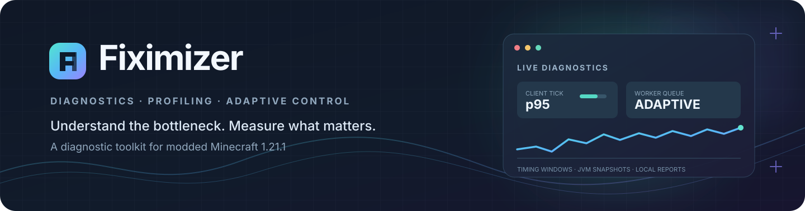
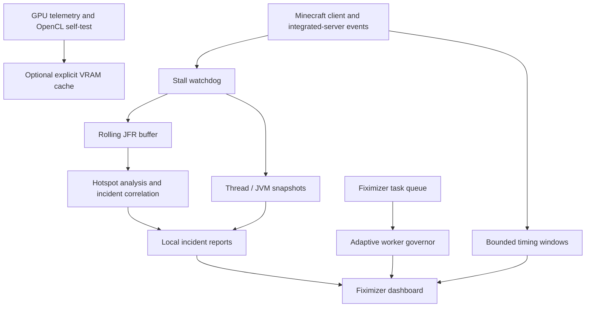

<div align="center">
  
  <p><strong>Measure the lag. Find the pressure point. Keep background work under control.</strong></p>
  <p><a href="README.md">English</a> · <a href="README.ru.md">Русский</a></p>
  <p>
    <a href="https://github.com/MAKAKAIglitch/Fiximizer/actions/workflows/build.yml"></a>
    <a href="https://github.com/MAKAKAIglitch/Fiximizer/stargazers"></a>
    <a href="https://github.com/MAKAKAIglitch/Fiximizer/blob/main/LICENSE"></a>
    
    
    
    
  </p>
</div>

---

## What is Fiximizer?

**Fiximizer is an experimental diagnostics and workload-management mod for Minecraft 1.21.1 on NeoForge.** It helps you investigate slowdowns by collecting bounded timing data, capturing JVM state during stalls, and exposing optional integrations for selected mods.

It combines:

- Client, render, integrated-server and selected mod-specific timing telemetry.
- A stall watchdog with JVM thread snapshots and rolling Java Flight Recorder (JFR) data.
- Local incident reports with statistical analysis and heuristic mod correlation.
- Five workload profiles, an adaptive worker governor and an automatic memory-pressure guard.
- Optional GPU telemetry, an OpenCL correctness benchmark and an experimental, bounded VRAM cache API.

> [!IMPORTANT]
> **Fiximizer is primarily a diagnostics tool, not a magic FPS booster.** Its scheduler controls only work submitted to Fiximizer's own executor. It does not rewrite arbitrary Minecraft code, change third-party mod thread priorities, or automatically move Create/Sable/game calculations to the GPU. No FPS or TPS improvement is guaranteed.

## Project map

| Resource | Link |
|---|---|
| Source code | [Repository](https://github.com/MAKAKAIglitch/Fiximizer) |
| Development builds | [GitHub Actions](https://github.com/MAKAKAIglitch/Fiximizer/actions/workflows/build.yml) |
| Tagged versions | [Releases](https://github.com/MAKAKAIglitch/Fiximizer/releases) |
| Bug reports | [Issues](https://github.com/MAKAKAIglitch/Fiximizer/issues) |
| Build instructions | [BUILDING.md](BUILDING.md) |
| License | [MIT](LICENSE) |


## Contents

- [How it works](#how-it-works)
- [Compatibility](#compatibility)
- [Getting started](#getting-started)
  - [Open the dashboard](#open-the-dashboard)
  - [Dashboard sections](#dashboard-sections)
- [Features](#features)
  - [Workload profiles](#workload-profiles)
  - [Runtime telemetry](#runtime-telemetry)
  - [Stall watchdog and Java Flight Recorder](#stall-watchdog-and-java-flight-recorder)
  - [Adaptive scheduler and memory guard](#adaptive-scheduler-and-memory-guard)
  - [GPU and VRAM tools](#gpu-and-vram-tools)
  - [Optional mod integrations](#optional-mod-integrations)
  - [JVM argument advisor](#jvm-argument-advisor)
- [Where reports are saved](#where-reports-are-saved)
- [Installation](#installation)
  - [Development builds](#development-builds)
  - [Build locally](#build-locally)
- [Development status](#development-status)
- [Bug reports and contributions](#bug-reports-and-contributions)
- [License](#license)

## How it works

The diagram shows the main data paths. Telemetry and incident reporting are separate from the scheduler that controls Fiximizer-owned tasks.



## Compatibility

| Component | Target |
|---|---|
| Minecraft | **1.21.1** |
| Mod loader | **NeoForge 21.1.256 and newer 21.1.x releases**, built against <code>21.1.256</code> |
| Java runtime | **Java 21** |
| Project version | **<code>0.14.0-alpha</code>** |
| Mod ID | <code>fiximizer</code> |

The declared Minecraft version range is <code>[1.21.1, 1.21.2)</code>. The NeoForge dependency range is <code>[21.1.256, 21.2)</code>: it accepts 21.1.256 and newer releases in the same 21.1 line, while staying on Minecraft 1.21.1. CI compiles against both the minimum supported version (21.1.256) and a newer 21.1.x baseline (21.1.265). Use a Java 21 runtime for the game instance.

Fiximizer includes English and Russian in-game translations.

## Getting started

### Open the dashboard

You can open the same control center in four ways:

- Press **F8**.
- Open **NeoForge Mods → Fiximizer → Config**.
- Run <code>/fiximizer</code>.
- Run <code>/fiximizer open</code> or <code>/fiximizer menu</code>.

Optional diagnostics startup is deliberately deferred until the title screen or a loaded world has been ticking for **40 stable client ticks** (about 2 seconds at 20 TPS). This keeps hardware probes and mod/JAR attribution work out of the critical initial client startup path.

### Dashboard sections

| Section | What it shows |
|---|---|
| Overview | Runtime summary, diagnostic state and manual snapshot action |
| Optimization | Selected profile, scheduler telemetry and memory-guard state |
| Integrations | Detected optional mods, versions and integration toggles |
| Physics | Sable physics and Create contraption telemetry |
| Java / JVM | Heap information, profiler controls and JVM argument advice |
| GPU / VRAM | GPU detection, optional sensor data, OpenCL discovery, benchmark and VRAM budget |
| Frames | Client render-call and client-tick timing |
| Server | Integrated single-player server tick timing |

## Features

### Workload profiles

Five presets regulate the amount and scheduling of **Fiximizer-owned background work**.

| Profile | Worker limit | Queue capacity | GPU policy |
|---|---:|---:|---|
| Game smoothness | 2 | 48 | Conservative |
| Low latency | 2 | 32 | Very conservative |
| Balanced | 3 | 128 | Standard adaptive |
| Maximum performance | 4 | 256 | More permissive |
| Memory saver | 1 | 16 | Disabled |

These are scheduler limits, not direct controls for Minecraft's render thread, tick thread or another mod's executors. Lowering a worker limit does not interrupt tasks that are already running.

### Runtime telemetry

Fiximizer uses bounded rolling windows, so its measurement history does not grow indefinitely.

| Area | Window | Reported metrics |
|---|---:|---|
| Client render call | 600 samples | Average, p50, p95, p99, peak and slow-sample count |
| Client tick | 600 samples | Average, p50, p95, p99, peak and slow-sample count |
| Integrated server tick | 600 ticks | Average, p50, p95, p99, peak and counts above 50 / 100 ms |
| Create contraption entities | 100 server ticks | Entity tick counts, average per-tick cost, peak and most expensive entity type |
| Sable physics | Latest 1,000 substeps | Count, average, peak, total time and highest-cost dimension |

Client timing can be disabled from **Frames**; integrated-server timing can be disabled from **Server**. Create and Sable measurements require the respective mod and an enabled Fiximizer integration.

<details>
<summary><strong>Measurement boundaries — read before interpreting the numbers</strong></summary>

- **Render-call duration is not frame presentation time.** It measures the wall-clock span inside <code>GameRenderer.render()</code>. It excludes presentation cadence and VSync waiting outside that call, and it is not GPU execution time.
- **Client tick time is not server tick time.** The client and integrated server have separate measurements.
- **Integrated-server timing is local.** It measures the full logical-server tick in a single-player world, including work by Create, Sable and other server-side mods. Do not add it to overlapping Create or Sable sub-profiler values.
- **Create telemetry is narrow by design.** It measures server-side ticks for entities inheriting <code>AbstractContraptionEntity</code>, not kinetic block entities, rendering or arbitrary Create methods.
- **Sable telemetry measures an event span.** It includes Java-side preparation, queued-force application, the physics pipeline (including native Rust/Rapier work), and pose/wake-up updates between Sable's public pre/post events. It is not a pure Rapier benchmark or native CPU-time breakdown.
- A measurement is evidence for investigation, not proof that a particular mod caused a slowdown.

</details>

### Stall watchdog and Java Flight Recorder

The watchdog observes three long-running event spans:

- Integrated server tick.
- Client tick.
- Render call.

A separate low-priority daemon checks active spans every **200 ms**. The default stall threshold is **2 seconds**. Repeated captures use bounded intervals and a configurable per-incident limit.

A capture can include:

- JVM thread names and stack traces captured at detection time.
- Heap, garbage-collector and other JVM counters.
- A rolling JFR recording with CPU execution samples, thread CPU load, garbage-collection events and sampled allocations.
- Best-effort class/package-to-mod attribution.

The default rolling JFR limits are **60 seconds / 64 MiB**. Stall-triggered exports are rate-limited (30 seconds by default), and retained exports are bounded. The live recorder continues after an export.

The mod/JAR class index is prepared on a background writer after deferred startup, rather than on the render or tick thread. Fiximizer can correlate the trigger-thread snapshot with JFR execution samples, rank candidate mods using several signals, and generate a self-contained HTML incident overview with a duration graph and links to local reports.

> Attribution and correlation are **heuristics**, not proof of causation. Shared packages, multi-mod JARs, transformed or hidden classes, and native code can remain unattributed. Continuous JFR recording can add CPU and disk overhead; <code>watchdog.rollingJfr</code> can be disabled in the generated NeoForge config while keeping text/thread snapshots.

### Adaptive scheduler and memory guard

The worker governor observes its own queue wait and task execution timings using a rolling window of the latest **128 tasks**. The dashboard exposes p95 timings, completed/failed/cancelled/rejected counters and the reason for the current worker policy.

- Adds at most one worker per diagnostics sample when queue pressure persists, all current workers are busy, and CPU headroom allows it.
- The queue-pressure threshold is **150 ms** for the oldest queued task or recent p95 queue wait.
- Reduces concurrency as system CPU load rises; at a profile's critical threshold it falls back to one worker.
- Gradually releases unused worker capacity when the scheduler is idle.
- Holds the current limit when CPU telemetry is unavailable.
- Respects the selected profile and a hard scheduler cap of four workers.

The automatic memory guard samples Java heap and available physical memory. Sustained pressure temporarily selects **Memory Saver**; after recovery, the previously selected profile is restored. Separate pressure and recovery thresholds help prevent rapid switching.

The guard does **not** call <code>System.gc()</code>, change JVM heap arguments at runtime, or unload objects owned by Minecraft or third-party mods. It reduces Fiximizer's own scheduling footprint.

### GPU and VRAM tools

The GPU page combines GPU identification, optional live sensor data, OpenCL discovery and a manual correctness benchmark.

**GPU telemetry availability**

Minecraft 1.21.1 ships with OSHI **6.4.10**. That version exposes GPU identity and total VRAM, but it predates the live <code>GpuStats</code> API. Therefore, on a stock 1.21.1 runtime, GPU utilization, used VRAM, temperature and power draw are reported as unavailable. Fiximizer checks for the newer sensor API reflectively when the runtime provides it; it does not fail startup when those optional methods are missing.

OpenCL discovery is independent of OSHI sensor support and checks for the installed OpenCL runtime and compute devices through LWJGL.

**OpenCL self-test**

The benchmark performs a vector addition over **1,048,576 elements** and validates every GPU output value against a CPU result. It measures OpenCL setup, upload time, average kernel time, download time and end-to-end GPU-path time.

The fixed working set uses three 4 MiB GPU buffers. CPU and GPU paths are warmed up before measurement. The benchmark runs on a daemon worker rather than the render thread. Its report is saved as <code>fiximizer-gpu-benchmark.txt</code> in the game directory.

A passing test confirms that the selected OpenCL device can run this test correctly. It does **not** prove that a real Minecraft workload will be faster on the GPU. Transfer time is included in the end-to-end comparison.

**Experimental VRAM cache**

Fiximizer contains an opt-in VRAM store for temporary cache blocks explicitly supplied by a Fiximizer integration.

- Default configured cap: **256 MiB**, adjustable up to **512 MiB**.
- Requires a successful OpenCL correctness test, active memory pressure and a live VRAM-used reading.
- Keeps a graphics reserve of at least **1.5 GiB or 20% of reported VRAM**, whichever is larger.
- Uses LRU eviction and explicit store, restore, discard and clear operations.

> [!WARNING]
> **On stock Minecraft 1.21.1, VRAM spilling is normally unavailable** because the bundled OSHI 6.4.10 does not expose used-VRAM telemetry. A compatible live GPU sensor API must be present before Fiximizer can calculate a safe spill budget. The cache is not extra Java heap, system RAM or a Windows page-file extension. It cannot move arbitrary Minecraft objects or third-party mod data. An integration must supply disposable data, preserve its handle and be able to rebuild data if the cache evicts it. No Create, Aeronautics or Sable object is automatically moved to VRAM. A restored direct buffer belongs to the caller and must be released with LWJGL <code>MemoryUtil.memFree</code>.

The OpenCL runtime / ICD is supplied by the installed graphics driver. Fiximizer does not install or replace GPU drivers.

### Optional mod integrations

Fiximizer detects loaded mod IDs and versions and gives each supported target an independent integration toggle.

| Mod | Current integration scope |
|---|---|
| Create | Passive server-side contraption entity tick profiler |
| Create: Aeronautics | Detection, version reporting and integration gate |
| Sable | Passive physics-substep telemetry via public NeoForge events |
| Distant Horizons | Detection, version reporting and integration gate |
| Voxy | Detection, version reporting and integration gate |

Create and Sable telemetry are diagnostic integrations: they do not cancel, reorder, accelerate or otherwise alter target-mod behavior. The other entries currently provide detection and conditional extension points; their presence does not mean optimization patches are shipped.

Intrusive Create / Aeronautics / Sable optimization work is not claimed as complete. It requires reproducible profiling data and version-specific compatibility tests first.

### JVM argument advisor

The Java / JVM page estimates conservative <code>-Xms</code> and <code>-Xmx</code> values using detected physical RAM and loaded mod count. It can copy the suggested line or save it to <code>config/fiximizer-jvm-arguments.txt</code>.

A running JVM cannot change its heap bounds. Paste the generated line into your launcher (for example, **Prism Launcher → Edit Instance → Settings → Java → JVM arguments**) and restart the game.

## Where reports are saved

Stall and incident reports are written locally to <code>logs/fiximizer/stalls/</code>.

| File | Purpose |
|---|---|
| <code>*.txt</code> | Thread snapshot, JVM counters, incident timeline and mod-attribution details |
| <code>*.jfr</code> | Exported rolling Java Flight Recorder data |
| <code>*-analysis.txt</code> | CPU hotspot and sampled-allocation analysis |
| <code>*-correlation.txt</code> | JFR / trigger-thread / mod-candidate correlation |
| <code>incident-&lt;id&gt;.html</code> | Local incident overview, duration graph and report links |

The Overview page also provides a manual diagnostic snapshot action. The HTML report uses local files only; it does not load remote scripts, fonts or services.

**Before sharing a report**, review it for information you do not want to publish. Stack traces, thread names, mod lists and profiling data may reveal details about your modpack or local environment.

## Installation

### Development builds

Development JARs are published through GitHub Actions:

1. Open the [Build workflow](https://github.com/MAKAKAIglitch/Fiximizer/actions/workflows/build.yml).
2. Select a successful run from the branch or commit you want.
3. Download the Linux or Windows artifact from the run's **Artifacts** section.
4. Place the Fiximizer JAR in the <code>mods</code> folder of your Minecraft 1.21.1 NeoForge instance.

The workflow builds on pushes and pull requests and retains uploaded artifacts for **14 days**. These are temporary CI builds, not permanent GitHub Releases. Check [Releases](https://github.com/MAKAKAIglitch/Fiximizer/releases) for tagged public versions.

### Build locally

See [BUILDING.md](BUILDING.md) for the full build process.

On Windows, run the included builder from the repository root:

```bat
build.bat
```

The builder searches for a full JDK 21. If none is available, it can download Eclipse Temurin 21 from the official Adoptium API, verify the SHA-256 checksum, and store the isolated JDK under <code>.tools/jdk-21-temurin</code>. It does not change system Java settings.

Manual Gradle build:

```powershell
gradlew.bat build
```

```bash
./gradlew build
```

The compiled mod JAR is written to <code>build/libs/</code>.

## Development status

**Current version: <code>0.14.0-alpha</code>.** Fiximizer is under active development. The checklist distinguishes implemented tooling from work that still needs real-world validation or implementation.

### Implemented

- [x] NeoForge 1.21.1 project foundation and five workload profiles.
- [x] Dashboard via F8, the NeoForge Mods Config button and client commands.
- [x] Russian and English in-game translations.
- [x] Deferred startup for optional diagnostics and hardware probes.
- [x] Adaptive worker governor with queue/run telemetry and CPU-headroom checks.
- [x] Automatic heap / physical-memory pressure guard.
- [x] JVM argument recommendation and export.
- [x] Optional-mod detection, version reporting and integration gates.
- [x] Client render-call, client-tick and integrated-server tick profilers.
- [x] Create contraption entity and Sable physics-substep profilers.
- [x] Stall watchdog with bounded JVM thread snapshots.
- [x] Rolling JFR capture, export, retention, hotspot analysis and trigger-thread correlation.
- [x] Heuristic mod attribution, incident timelines and local HTML overview.
- [x] GPU identification, optional sensor probing and OpenCL discovery.
- [x] Bounded OpenCL correctness self-test.
- [x] VRAM budgeting and explicit disposable-cache API (requires live used-VRAM telemetry).

### Planned / needs validation

- [ ] Validate client, render and integrated-server telemetry in real 1.21.1 modpacks against external measurements.
- [ ] Develop the first Create and Sable optimizations from reproducible profiling data.
- [ ] Benchmark actual Fiximizer-owned workloads with CPU / GPU comparisons.
- [ ] Add a real OpenCL kernel for an actual Fiximizer-owned workload.
- [ ] Use the VRAM cache in an integration with serialization and rebuild support.
- [ ] Add rolling benchmark comparisons and before / after reports.

## Bug reports and contributions

Found a bug or an incorrect measurement? Please [open an issue](https://github.com/MAKAKAIglitch/Fiximizer/issues/new) and include, when possible:

- Minecraft, NeoForge, Fiximizer and Java versions.
- The relevant mod list and a short description of the environment.
- Exact reproduction steps and what you expected to happen.
- The relevant Fiximizer report or log excerpt.

For profiling-related issues, describe whether the measurement came from the client, render call, integrated server, Create or Sable. Remove private information from logs and reports before attaching them.

Browse the [source code](https://github.com/MAKAKAIglitch/Fiximizer), [CI runs](https://github.com/MAKAKAIglitch/Fiximizer/actions), [open issues](https://github.com/MAKAKAIglitch/Fiximizer/issues) and [contributors](https://github.com/MAKAKAIglitch/Fiximizer/graphs/contributors).

## License

Fiximizer is distributed under the [MIT License](LICENSE).
