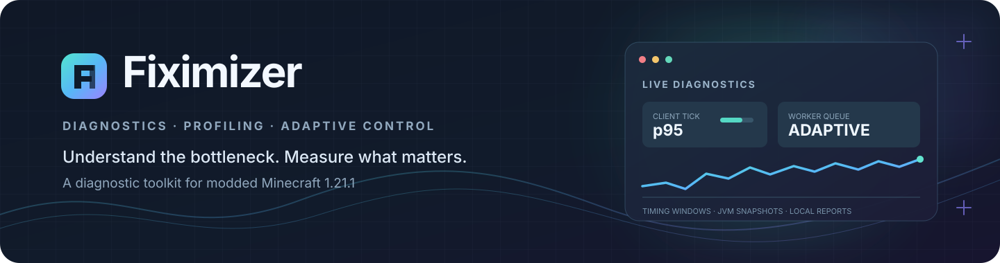
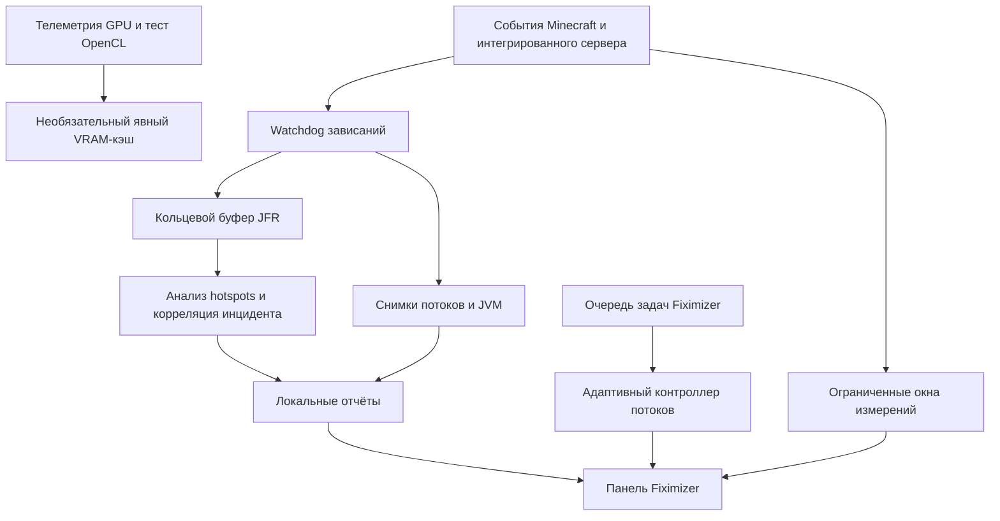

<div align="center">
  
  <p><strong>Измеряй лаги. Находи узкие места. Контролируй фоновую нагрузку.</strong></p>
  <p><a href="README.md">English</a> · <a href="README.ru.md">Русский</a></p>
  <p>
    <a href="https://github.com/MAKAKAIglitch/Fiximizer/actions/workflows/build.yml"></a>
    <a href="https://github.com/MAKAKAIglitch/Fiximizer/stargazers"></a>
    <a href="https://github.com/MAKAKAIglitch/Fiximizer/blob/main/LICENSE"></a>
    
    
    
    
  </p>
</div>

---

## Что такое Fiximizer?

**Fiximizer — экспериментальный мод для диагностики и управления фоновой нагрузкой в Minecraft 1.21.1 на NeoForge.** Он помогает разобраться в причинах подвисаний: собирает ограниченную по размеру статистику времени выполнения, фиксирует состояние JVM во время зависаний и предоставляет необязательные интеграции с некоторыми модами.

Возможности проекта:

- Телеметрия клиентского потока, рендера, интегрированного сервера и отдельных модовых подсистем.
- Watchdog зависаний со снимками потоков JVM и кольцевой записью Java Flight Recorder (JFR).
- Локальные отчёты об инцидентах со статистическим анализом и эвристической корреляцией с модами.
- Пять профилей нагрузки, адаптивный контроллер фоновых задач и автоматическая защита при нехватке памяти.
- Необязательная телеметрия GPU, тест корректности OpenCL и экспериментальный ограниченный API VRAM-кэша.

> [!IMPORTANT]
> **Fiximizer в первую очередь предназначен для диагностики, а не для магического повышения FPS.** Планировщик управляет только задачами, которые отправлены в собственный executor Fiximizer. Мод не переписывает произвольный код Minecraft, не меняет приоритеты потоков сторонних модов и не переносит автоматически вычисления Create/Sable/игры на видеокарту. Гарантии прироста FPS или TPS нет.

## Навигация по проекту

| Ресурс | Ссылка |
|---|---|
| Исходный код | [Репозиторий](https://github.com/MAKAKAIglitch/Fiximizer) |
| Dev-сборки | [GitHub Actions](https://github.com/MAKAKAIglitch/Fiximizer/actions/workflows/build.yml) |
| Опубликованные версии | [Releases](https://github.com/MAKAKAIglitch/Fiximizer/releases) |
| Сообщить об ошибке | [Issues](https://github.com/MAKAKAIglitch/Fiximizer/issues) |
| Инструкция по сборке | [BUILDING.md](BUILDING.md) |
| Лицензия | [MIT](LICENSE) |


## Содержание

- [Как устроен Fiximizer](#как-устроен-fiximizer)
- [Совместимость](#совместимость)
- [Быстрый старт](#быстрый-старт)
  - [Как открыть панель](#как-открыть-панель)
  - [Разделы панели управления](#разделы-панели-управления)
- [Возможности](#возможности)
  - [Профили нагрузки](#профили-нагрузки)
  - [Телеметрия в реальном времени](#телеметрия-в-реальном-времени)
  - [Watchdog зависаний и Java Flight Recorder](#watchdog-зависаний-и-java-flight-recorder)
  - [Адаптивный планировщик и защита памяти](#адаптивный-планировщик-и-защита-памяти)
  - [Инструменты GPU и VRAM](#инструменты-gpu-и-vram)
  - [Необязательные интеграции с модами](#необязательные-интеграции-с-модами)
  - [Советник параметров JVM](#советник-параметров-jvm)
- [Где находятся отчёты](#где-находятся-отчёты)
- [Установка](#установка)
  - [Dev-сборки](#dev-сборки)
  - [Локальная сборка](#локальная-сборка)
- [Статус разработки](#статус-разработки)
- [Сообщить об ошибке и помочь проекту](#сообщить-об-ошибке-и-помочь-проекту)
- [Лицензия](#лицензия)

## Как устроен Fiximizer

На схеме показаны основные потоки данных. Телеметрия и отчёты об инцидентах отделены от планировщика, который управляет только задачами самого Fiximizer.



## Совместимость

| Компонент | Целевая версия |
|---|---|
| Minecraft | **1.21.1** |
| Загрузчик модов | **NeoForge 21.1.256 и новее в линейке 21.1.x** |
| Java | **Java 21** |
| Версия проекта | **<code>0.14.0-alpha</code>** |
| Mod ID | <code>fiximizer</code> |

Версия Minecraft ограничена диапазоном <code>[1.21.1, 1.21.2)</code>. Диапазон NeoForge — <code>[21.1.256, 21.2)</code>: поддерживаются релизы 21.1.256 и новее в той же ветке 21.1.x. CI отдельно собирает и тестирует минимальную версию 21.1.256 и более новую контрольную версию 21.1.265. Для игрового экземпляра используй Java 21.

В интерфейсе мода доступны английский и русский переводы.

## Быстрый старт

### Как открыть панель

Один и тот же центр управления можно открыть четырьмя способами:

- Нажать **F8**.
- Открыть **NeoForge Mods → Fiximizer → Config**.
- Выполнить команду <code>/fiximizer</code>.
- Выполнить <code>/fiximizer open</code> или <code>/fiximizer menu</code>.

Запуск необязательной диагностики специально отложен до тех пор, пока титульный экран или загруженный мир не проработает **40 стабильных клиентских тиков** (примерно 2 секунды при 20 TPS). Это не позволяет проверке оборудования и анализу JAR-файлов конкурировать с критически важной начальной загрузкой клиента.

### Разделы панели управления

| Раздел | Что показывает |
|---|---|
| Overview | Общая сводка, состояние диагностики и ручной снимок |
| Optimization | Активный профиль, телеметрия планировщика и защита памяти |
| Integrations | Обнаруженные моды, версии и переключатели интеграций |
| Physics | Телеметрия физики Sable и контрапшенов Create |
| Java / JVM | Информация о heap, профилировщик и рекомендации параметров JVM |
| GPU / VRAM | Обнаружение GPU, доступные датчики, OpenCL, тест и бюджет VRAM |
| Frames | Время вызова рендера и клиентского тика |
| Server | Время тика локального интегрированного сервера |

## Возможности

### Профили нагрузки

Пять профилей регулируют количество и планирование **фоновых задач самого Fiximizer**.

| Профиль | Лимит потоков | Ёмкость очереди | Политика GPU |
|---|---:|---:|---|
| Плавность игры | 2 | 48 | Консервативная |
| Низкая задержка | 2 | 32 | Очень консервативная |
| Сбалансированный | 3 | 128 | Стандартная адаптивная |
| Максимальная производительность | 4 | 256 | Более свободная |
| Экономия памяти | 1 | 16 | Отключена |

Это ограничения планировщика Fiximizer, а не прямое управление потоком рендера Minecraft, игровым тиком или executor стороннего мода. Снижение лимита не прерывает задачи, которые уже выполняются.

### Телеметрия в реальном времени

Fiximizer использует ограниченные скользящие окна — история измерений не растёт бесконечно.

| Область | Окно | Доступные метрики |
|---|---:|---|
| Вызов клиентского рендера | 600 измерений | Среднее, p50, p95, p99, максимум и количество медленных измерений |
| Клиентский тик | 600 измерений | Среднее, p50, p95, p99, максимум и количество медленных измерений |
| Тик интегрированного сервера | 600 тиков | Среднее, p50, p95, p99, максимум и количество тиков дольше 50 / 100 мс |
| Контрапшены Create | 100 серверных тиков | Число тиков сущностей, средняя стоимость за тик, максимум и самый затратный тип сущности |
| Физика Sable | Последние 1 000 подшагов | Количество, среднее, максимум, суммарное время и измерение с наибольшей нагрузкой |

Клиентские измерения можно отключить на странице **Frames**, измерения интегрированного сервера — на странице **Server**. Для метрик Create и Sable соответствующий мод должен быть установлен, а интеграция Fiximizer — включена.

<details>
<summary><strong>Границы измерений — обязательно прочитай перед интерпретацией цифр</strong></summary>

- **Время вызова рендера — не время вывода кадра на экран.** Измеряется длительность участка внутри <code>GameRenderer.render()</code>. Ожидание VSync и интервал между фактически показанными кадрами за его пределами не учитываются. Это также не измерение времени выполнения GPU.
- **Время клиентского тика не равно времени серверного тика.** Клиент и интегрированный сервер измеряются отдельно.
- **Измерение интегрированного сервера локальное.** Оно охватывает полный тик логического сервера в одиночном мире, включая работу Create, Sable и других серверных модов. Не складывай его с показателями вложенных профилировщиков Create или Sable: интервалы пересекаются.
- **Телеметрия Create имеет ограниченную область.** Она измеряет серверные тики сущностей, наследующих <code>AbstractContraptionEntity</code>, но не кинетические блок-сущности, рендер или произвольные методы Create.
- **Телеметрия Sable измеряет временной интервал событий.** В него входят Java-подготовка, применение очереди сил, вызов физического конвейера (включая native Rust/Rapier), обновление поз и пробуждение между публичными событиями Sable pre/post. Это не чистый бенчмарк Rapier и не разбор времени выполнения native-кода по CPU.
- Измерения помогают искать причину, но сами по себе не доказывают, что виноват конкретный мод.

</details>

### Watchdog зависаний и Java Flight Recorder

Watchdog отслеживает три длительных участка выполнения:

- Тик интегрированного сервера.
- Клиентский тик.
- Вызов рендера.

Отдельный низкоприоритетный daemon-поток проверяет активные участки каждые **200 мс**. Порог зависания по умолчанию — **2 секунды**. Повторные снимки делаются через ограниченные интервалы, а их количество для одного инцидента настраивается.

Снимок может включать:

- Имена потоков JVM и stack trace, захваченные непосредственно в момент обнаружения.
- Состояние heap, счётчики сборщика мусора и другие показатели JVM.
- Кольцевую запись JFR с CPU execution samples, нагрузкой потоков, событиями GC и выборочными данными об аллокациях.
- Эвристическое сопоставление классов и пакетов с модами.

По умолчанию кольцевой буфер JFR хранит данные не старше **60 секунд** и ограничен размером **64 МиБ**. Экспорт JFR при зависании ограничен интервалом (по умолчанию 30 секунд), а число сохраняемых экспортов ограничено. После экспорта текущая запись продолжает работать.

Индекс классов и JAR-файлов модов подготавливается в фоновом writer-потоке после отложенного запуска диагностики, а не в потоке рендера или тиков. Fiximizer умеет сопоставлять снимок потока, вызвавшего зависание, с execution samples из JFR, ранжировать возможные причины по нескольким признакам и создавать автономную HTML-сводку инцидента с графиком длительности и ссылками на локальные отчёты.

> Сопоставление и корреляция — **эвристика, а не доказательство причины**. Общие пакеты, JAR с несколькими модами, преобразованные или скрытые классы и native-код могут остаться без атрибуции. Постоянная запись JFR может создавать нагрузку на CPU и диск. Параметр <code>watchdog.rollingJfr</code> в конфигурации NeoForge позволяет отключить кольцевую JFR-запись, сохранив текстовые снимки потоков.

### Адаптивный планировщик и защита памяти

Контроллер рабочих потоков измеряет ожидание в собственной очереди и время выполнения собственных задач Fiximizer, используя скользящее окно последних **128 задач**. В панели доступны p95 задержки, счётчики завершённых/неудачных/отменённых/отклонённых задач и причина текущей политики планировщика.

- Добавляет не более одного рабочего потока за цикл диагностики, если очередь стабильно перегружена, все текущие потоки заняты и у системы достаточно свободного CPU.
- Порог давления очереди — **150 мс** для самой старой задачи или недавнего p95 ожидания.
- Снижает параллелизм при росте загрузки CPU; при критическом пороге выбранного профиля оставляет один поток.
- Постепенно освобождает неиспользуемую мощность, когда очередь простаивает.
- Сохраняет текущий лимит, если телеметрия CPU недоступна.
- Учитывает выбранный профиль и жёсткий предел в четыре рабочих потока.

Автоматическая защита памяти следит за Java heap и доступной физической памятью. При длительном давлении она временно переключает Fiximizer на профиль **Экономия памяти**, а после восстановления возвращает ранее выбранный профиль. Раздельные пороги срабатывания и восстановления помогают избежать постоянного переключения.

Защита памяти **не** вызывает <code>System.gc()</code>, не меняет параметры heap работающей JVM и не выгружает объекты Minecraft или сторонних модов. Она уменьшает собственную фоновую нагрузку Fiximizer.

### Инструменты GPU и VRAM

Раздел GPU объединяет определение видеокарты, доступные live-датчики, обнаружение OpenCL и ручной тест корректности вычислений.

**Доступность телеметрии GPU**

В Minecraft 1.21.1 используется OSHI **6.4.10**. Эта версия позволяет получить название GPU и общий объём VRAM, но появилась раньше live API <code>GpuStats</code>. Поэтому в стандартной среде Minecraft 1.21.1 загрузка GPU, занятая VRAM, температура и энергопотребление отображаются как недоступные. Fiximizer проверяет наличие более нового API датчиков через reflection, если он предоставлен runtime, и не ломает запуск при отсутствии необязательных методов.

Обнаружение OpenCL не зависит от датчиков OSHI: через LWJGL отдельно проверяется наличие установленного OpenCL runtime и вычислительных устройств.

**Тест OpenCL**

Бенчмарк выполняет сложение векторов размером **1 048 576 элементов** и проверяет каждый элемент результата GPU по результату CPU. Измеряются создание OpenCL-контекста и ядра, время загрузки данных, среднее время выполнения ядра, время чтения результата и полное время GPU-пути.

Используется фиксированный набор из трёх GPU-буферов по 4 МиБ. CPU- и GPU-пути прогреваются до измерения. Тест выполняется в daemon-потоке, а не в потоке рендера. Отчёт сохраняется в <code>fiximizer-gpu-benchmark.txt</code> в папке игры.

Успешный тест подтверждает, что выбранное OpenCL-устройство корректно выполняет именно эту операцию. Он **не** доказывает, что реальная нагрузка Minecraft будет быстрее на видеокарте. В итоговом сравнении учитывается время передачи данных.

**Экспериментальный VRAM-кэш**

В Fiximizer есть опциональное хранилище VRAM для временных блоков кэша, которые интеграция Fiximizer явно передала ему.

- Лимит по умолчанию — **256 МиБ**, настраивается до **512 МиБ**.
- Требуются успешный тест OpenCL, активное давление на память и доступное измерение занятой VRAM.
- Оставляет резерв для графики не менее **1,5 ГиБ или 20% объёма VRAM** — в зависимости от того, что больше.
- Использует LRU-вытеснение и явные операции сохранения, восстановления, удаления и очистки.

> [!WARNING]
> **В стандартном Minecraft 1.21.1 перенос в VRAM обычно недоступен**, поскольку встроенная OSHI 6.4.10 не предоставляет данные о занятой VRAM. Для расчёта безопасного бюджета нужен совместимый live API датчиков GPU. Кэш — это не расширение Java heap, оперативной памяти или файла подкачки Windows. Он не может перемещать произвольные объекты Minecraft или данные сторонних модов. Интеграция должна сама передать временные данные, сохранить handle и уметь восстановить данные после вытеснения. Объекты Create, Aeronautics или Sable автоматически в VRAM не перемещаются. Восстановленный direct buffer принадлежит вызывающей стороне и должен быть освобождён через LWJGL <code>MemoryUtil.memFree</code>.

OpenCL runtime / ICD предоставляет установленный драйвер видеокарты. Fiximizer не устанавливает и не заменяет драйверы GPU.

### Необязательные интеграции с модами

Fiximizer обнаруживает ID и версии установленных модов и предоставляет отдельный переключатель интеграции для каждой поддерживаемой цели.

| Мод | Текущий объём интеграции |
|---|---|
| Create | Пассивный профилировщик серверных тиков сущностей-контрапшенов |
| Create: Aeronautics | Обнаружение, отображение версии и переключатель интеграции |
| Sable | Пассивная телеметрия физических подшагов через публичные события NeoForge |
| Distant Horizons | Обнаружение, отображение версии и переключатель интеграции |
| Voxy | Обнаружение, отображение версии и переключатель интеграции |

Интеграции Create и Sable предназначены для диагностики: они не отменяют, не переставляют, не ускоряют и иным образом не меняют поведение целевого мода. Остальные пункты пока предоставляют обнаружение и условные точки расширения; их наличие не означает, что готовые патчи оптимизации уже поставляются.

Мы намеренно не заявляем о готовой глубокой оптимизации Create / Aeronautics / Sable. Для неё сначала нужны воспроизводимые профили нагрузки и проверки совместимости для конкретных версий.

### Советник параметров JVM

Раздел Java / JVM оценивает консервативные значения <code>-Xms</code> и <code>-Xmx</code> на основе объёма физической памяти и количества загруженных модов. Предложенную строку можно скопировать или сохранить в <code>config/fiximizer-jvm-arguments.txt</code>.

Работающая JVM не может изменить границы heap. Вставь сгенерированную строку в настройки лаунчера (например, **Prism Launcher → Edit Instance → Settings → Java → JVM arguments**) и перезапусти игру.

## Где находятся отчёты

Отчёты о зависаниях и инцидентах сохраняются локально в <code>logs/fiximizer/stalls/</code>.

| Файл | Назначение |
|---|---|
| <code>*.txt</code> | Снимок потоков, счётчики JVM, временная шкала инцидента и атрибуция модов |
| <code>*.jfr</code> | Экспортированные данные Java Flight Recorder |
| <code>*-analysis.txt</code> | Анализ CPU hotspots и выборочных аллокаций |
| <code>*-correlation.txt</code> | Корреляция JFR, потока-триггера и возможных модов |
| <code>incident-&lt;id&gt;.html</code> | Локальная сводка, график длительности и ссылки на отчёты |

На странице Overview также есть кнопка ручного диагностического снимка. HTML-отчёт использует только локальные файлы и не загружает удалённые скрипты, шрифты или сервисы.

**Перед отправкой отчёта** проверь его на наличие информации, которую ты не хочешь публиковать. Stack trace, имена потоков, список модов и данные профилирования могут раскрывать подробности твоей сборки или локального окружения.

## Установка

### Dev-сборки

JAR-файлы для разработки публикуются через GitHub Actions:

1. Открой [workflow сборки](https://github.com/MAKAKAIglitch/Fiximizer/actions/workflows/build.yml).
2. Выбери успешный запуск для нужной ветки или коммита.
3. Скачай Linux- или Windows-артефакт в разделе **Artifacts** этого запуска.
4. Помести JAR Fiximizer в папку <code>mods</code> экземпляра Minecraft 1.21.1 с NeoForge.

Workflow собирает проект при push и pull request, а загруженные артефакты хранятся **14 дней**. Это временные CI-сборки, а не постоянные GitHub Releases. Опубликованные версии можно будет найти в разделе [Releases](https://github.com/MAKAKAIglitch/Fiximizer/releases).

### Локальная сборка

Подробная инструкция находится в [BUILDING.md](BUILDING.md).

В Windows запусти сборщик из корневой папки репозитория:

```bat
build.bat
```

Сборщик ищет полноценный JDK 21. Если его нет, скрипт может скачать Eclipse Temurin 21 через официальный Adoptium API, проверить архив по SHA-256 и сохранить отдельный JDK в <code>.tools/jdk-21-temurin</code>. Системные настройки Java при этом не меняются.

Ручная сборка Gradle:

```powershell
gradlew.bat build
```

```bash
./gradlew build
```

Собранный JAR появится в <code>build/libs/</code>.

## Статус разработки

**Текущая версия: <code>0.14.0-alpha</code>.** Fiximizer продолжает активно разрабатываться. Ниже отдельно отмечены готовые инструменты и задачи, которым ещё нужны проверки или реализация.

### Уже реализовано

- [x] Основа проекта для NeoForge 1.21.1 и пять профилей нагрузки.
- [x] Панель управления через F8, кнопку Config в списке модов NeoForge и клиентские команды.
- [x] Русский и английский переводы интерфейса.
- [x] Отложенный запуск необязательной диагностики и проверок оборудования.
- [x] Адаптивный контроллер рабочих потоков, телеметрия очереди и проверка свободной мощности CPU.
- [x] Автоматическая защита при давлении на heap / физическую память.
- [x] Рекомендации и экспорт аргументов JVM.
- [x] Обнаружение необязательных модов, отображение версий и переключатели интеграций.
- [x] Профилировщики вызовов клиентского рендера, клиентских тиков и тиков интегрированного сервера.
- [x] Профилировщик тиков сущностей-контрапшенов Create и физических подшагов Sable.
- [x] Watchdog зависаний и ограниченные снимки потоков JVM.
- [x] Кольцевая запись JFR, экспорт, ограничение хранения, анализ hotspots и корреляция с потоком-триггером.
- [x] Эвристическая атрибуция модов, временная шкала инцидентов и локальная HTML-сводка.
- [x] Обнаружение GPU, проверка доступности датчиков и поиск OpenCL.
- [x] Ограниченный тест корректности OpenCL.
- [x] Расчёт бюджета VRAM и API явного кэширования временных блоков (требуется live-измерение занятой VRAM).

### В планах / требует проверки

- [ ] Проверить телеметрию клиентского рендера, тиков и интегрированного сервера в реальных сборках 1.21.1 с внешними измерениями.
- [ ] Разработать первые оптимизации Create и Sable на основе воспроизводимых профилей нагрузки.
- [ ] Сравнивать CPU и GPU на реальных задачах, принадлежащих Fiximizer.
- [ ] Добавить настоящее OpenCL-ядро для конкретной задачи Fiximizer.
- [ ] Подключить VRAM-кэш к интеграции с сериализацией и возможностью восстановления данных.
- [ ] Добавить сравнение бенчмарков до и после изменений.

## Сообщить об ошибке и помочь проекту

Нашёл ошибку или некорректное измерение? [Создай issue](https://github.com/MAKAKAIglitch/Fiximizer/issues/new) и по возможности укажи:

- Версии Minecraft, NeoForge, Fiximizer и Java.
- Список связанных модов и краткое описание окружения.
- Точные шаги воспроизведения и ожидаемое поведение.
- Подходящий отчёт Fiximizer или фрагмент лога.

Для проблем с профилированием уточни, откуда получено измерение: клиент, рендер, интегрированный сервер, Create или Sable. Перед прикреплением логов и отчётов удали личную информацию.

Также доступны [исходный код](https://github.com/MAKAKAIglitch/Fiximizer), [запуски CI](https://github.com/MAKAKAIglitch/Fiximizer/actions), [открытые issues](https://github.com/MAKAKAIglitch/Fiximizer/issues) и [список участников](https://github.com/MAKAKAIglitch/Fiximizer/graphs/contributors).

## Лицензия

Fiximizer распространяется под лицензией [MIT](LICENSE).
