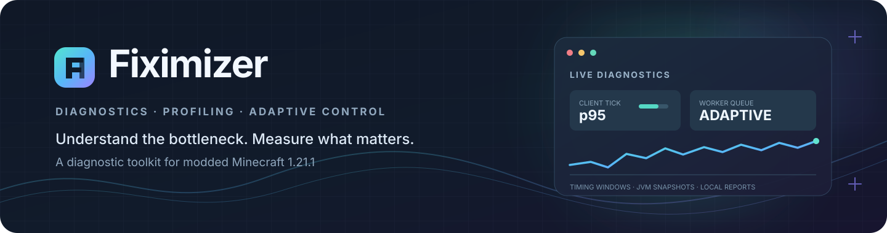

  

  
<strong>Измеряй узкие места. Находи причины. Настраивай то, чем действительно управляет Fiximizer.</strong>

  

    <a href="README.md">English version</a> ·
    <a href="https://github.com/MAKAKAIglitch/Fiximizer/actions/workflows/build.yml">Сборки CI</a> ·
    <a href="https://github.com/MAKAKAIglitch/Fiximizer/issues">Проблемы и предложения</a> ·
    <a href="BUILDING.md">Инструкция по сборке</a>
  

  

    
    
    
    
    
    
    
    
  

> [!IMPORTANT]
> **Fiximizer — альфа-версия мода для диагностики и управления нагрузкой.** Он измеряет отдельные участки работы Minecraft, помогает расследовать зависания и адаптирует собственный планировщик фоновых задач. Мод **не обещает универсального прироста FPS**, не переписывает произвольный код других модов и не переносит вычисления Minecraft на видеокарту автоматически.

## Содержание

- [О проекте](#о-проекте)
- [Возможности](#возможности)
- [Игровая панель](#игровая-панель)
- [Профили и адаптивный планировщик](#профили-и-адаптивный-планировщик)
- [Оптимизатор памяти](#оптимизатор-памяти)
- [Диагностика и отчёты](#диагностика-и-отчёты)
- [Интеграции с другими модами](#интеграции-с-другими-модами)
- [GPU, OpenCL и VRAM](#gpu-opencl-и-vram)
- [Совместимость](#совместимость)
- [Установка](#установка)
- [Сборка из исходников](#сборка-из-исходников)
- [Планы разработки](#планы-разработки)
- [Сообщения об ошибках и вклад в проект](#сообщения-об-ошибках-и-вклад-в-проект)
- [Лицензия](#лицензия)

## О проекте

**Fiximizer** — открытый набор инструментов для диагностики и профилирования модифицированного **Minecraft Java Edition 1.21.1** под **NeoForge**.

С его помощью можно разобраться в практических вопросах:

- Сколько времени занимает вызов рендера, клиентский тик или тик встроенного сервера?
- Что происходило внутри JVM, когда игра перестала отвечать?
- Какой поток, метод или пакет мода стоит исследовать?
- Не накапливаются ли собственные фоновые задачи Fiximizer в очереди?
- Испытывает ли система нехватку памяти?
- Работает ли OpenCL на установленной видеокарте корректно и быстрее ли он для конкретного теста?

Fiximizer объединяет ограниченные по размеру окна измерений, Java Flight Recorder (JFR), отчёты об инцидентах, необязательную телеметрию интеграций и адаптивный планировщик собственных задач мода.

## Возможности

| Направление | Что уже реализовано |
|---|---|
| Игровая панель | Девять разделов, включая отдельную вкладку оптимизатора памяти |
| Клиентские измерения | Длительность вызова `GameRenderer.render()` и клиентского тика с расчётом перцентилей |
| Измерения встроенного сервера | Полная длительность тика локального одиночного мира |
| Контроль зависаний | Обнаружение длительных событий клиентского тика, рендера и встроенного сервера; снимки потоков JVM |
| JFR-профилирование | Ограниченная кольцевая запись, экспорт снимков, анализ CPU/аллокаций и корреляция инцидентов |
| Отчёты об инцидентах | Связанные снимки, временная шкала, ранжированные гипотезы для расследования и локальный HTML-отчёт |
| Контроль памяти | Временное переключение Fiximizer в режим экономии памяти при устойчивом давлении на память |
| Оптимизатор памяти | Необязательная ограниченная дедупликация строк метаданных интеграций, счётчики повторного использования и рекомендация G1 для JVM |
| Адаптивный планировщик | Управление собственными worker-потоками, p95 задержки очереди и счётчики задач |
| Рекомендации JVM | Подбор `-Xms` / `-Xmx` по объёму обнаруженной RAM и числу загруженных модов |
| Дополнительные интеграции | Обнаружение Create, Create Aeronautics, Sable, Distant Horizons и Voxy и отдельные переключатели |
| Диагностика GPU | Поиск GPU/OpenCL и ручной тест сложения массивов с проверкой результата |
| VRAM-кэш | Ограниченный кэш временных данных, которые интеграция явно передала Fiximizer |

### Как устроены основные компоненты

~~~mermaid
flowchart TD
    A["События Minecraft + NeoForge"] --> B["Ограниченные окна измерений"]
    B --> C["Игровая панель"]
    B --> D["Stall Watchdog"]
    D --> E["Снимки потоков JVM + кольцевой JFR"]
    E --> F["Анализ и корреляция инцидента"]
    F --> G["Локальные текстовые и HTML-отчёты"]
    H["Очередь задач Fiximizer"] --> I["Адаптивный планировщик"]
    J["Необязательные события Create / Sable"] --> B
    K["Обнаружение OpenCL и ручной тест"] --> L["Отчёт с проверкой результата"]
~~~

## Игровая панель

Открыть одну и ту же панель можно несколькими способами:

| Способ | Действие |
|---|---|
| Горячая клавиша | Нажать **F8** |
| Список модов NeoForge | Выбрать Fiximizer и нажать **Config** |
| Клиентская команда | `/fiximizer` |
| Клиентская команда | `/fiximizer open` |
| Клиентская команда | `/fiximizer menu` |

Интерфейс доступен на русском и английском языках.

В панели восемь разделов:

1. **Обзор** — состояние игры и памяти, активный профиль, ручные снимки диагностики.
2. **Оптимизация** — выбранный и фактически действующий профиль, контроль памяти.
3. **Интеграции** — обнаруженные моды, их версии и индивидуальные переключатели.
4. **Физика** — телеметрия контрапций Create и физики Sable.
5. **Java / JVM** — сведения о среде, управление JFR и рекомендации JVM-аргументов.
6. **GPU / VRAM** — состояние GPU и OpenCL, тест и управление явным VRAM-кэшем.
7. **Кадры** — измерения вызова рендера и клиентского тика.
8. **Сервер** — измерения тиков встроенного одиночного сервера.
9. **Память** — счётчики ограниченного совместного использования строк и необязательная рекомендация G1 String Deduplication.

Необязательные аппаратные проверки и запуск watchdog отложены до главного меню или загруженного мира после **40 стабильных клиентских тиков** (примерно две секунды). Это позволяет не конкурировать с критическим этапом начальной загрузки.

## Профили и адаптивный планировщик

В Fiximizer есть пять режимов. Они регулируют только собственные фоновые задачи мода: не меняют приоритет потока рендера Minecraft, не переставляют игровые тики и не управляют worker-пулами других модов.

| Профиль | Лимит worker-потоков | Размер очереди | Политика OpenCL |
|---|---:|---:|---|
| Плавность игры | 2 | 48 | Консервативная |
| Минимальная задержка | 2 | 32 | Очень консервативная |
| Сбалансированный | 3 | 128 | Стандартная адаптивная |
| Максимальная производительность | 4 | 256 | Более разрешительная |
| Экономия памяти | 1 | 16 | Отключена |

### Адаптивное управление worker-потоками

Планировщик ведёт статистику последних **128 задач**: времени ожидания в очереди и длительности выполнения. В панели показываются p95 этих показателей, а также счётчики завершённых, неудачных, отменённых и отклонённых задач.

- Начинает с консервативного лимита и добавляет не более одного worker-потока за диагностический цикл, если очередь устойчиво задерживается, все потоки заняты и у CPU есть запас.
- Уменьшает параллелизм при росте загрузки CPU. При критическом пороге выбранного профиля оставляет один worker-поток.
- Постепенно освобождает неиспользуемую мощность при пустой очереди.
- Если телеметрия CPU недоступна, сохраняет текущий лимит вместо предположения, что ресурсы свободны.
- Общий максимум — четыре worker-потока. Снижение лимита не прерывает уже выполняющиеся задачи.

Это планировщик независимых задач самого Fiximizer, а не универсальный оптимизатор потоков Minecraft. Измерение очереди не гарантирует повышения FPS.

### Автоматическая защита памяти

Контроллер отслеживает использование Java heap и доступную физическую RAM. Когда настроенные условия нехватки памяти сохраняются, Fiximizer временно переключается в режим **Экономия памяти**. Для включения и восстановления используются разные пороги и несколько последовательных измерений.

После восстановления памяти возвращается ранее выбранный профиль. Контроллер не вызывает `System.gc()`, не выгружает объекты других модов и не меняет лимиты heap уже запущенной JVM.

## Оптимизатор памяти

На вкладке «Память» доступны два независимых механизма:

- **Ограниченная дедупликация строк:** необязательная таблица со слабыми ссылками для неизменяемых строк, явно переданных через API интеграций Fiximizer. Используются 16 корзин по четыре слота (всего 64); после совпадения хеша проверяется полное равенство строк. Строки короче восьми символов пропускаются. После трёх неудачных compare-and-set попыток кэш пропускает операцию вместо бесконечного ожидания или блокировки.
- **Рекомендация G1 String Deduplication для JVM:** необязательный аргумент запуска. Он предлагается только при обнаруженном G1 и применяется после перезапуска игры. Во время сборки мусора G1 может тратить дополнительное время CPU; настройка по умолчанию выключена.

Таблица создаётся лениво после включения функции и освобождается при её отключении. Мод не сканирует heap, не переписывает произвольные графы объектов Minecraft или других модов и не запускает периодические фоновые задачи.

**Текущая область действия намеренно небольшая:** первый адаптер охватывает метаданные отдельных необязательных модов (ID и строки версий). Это фундамент для интеграций, а не обещание сжатия heap всей сборки. В счётчик дедупликации попадает только повторное использование другого, равного по содержимому объекта String; повторный вызов с тем же экземпляром не считается экономией. Ноль попаданий означает, что экономия пока не зафиксирована. См. [заметки о реализации оптимизатора памяти](docs/MEMORY_OPTIMIZER.md).

## Диагностика и отчёты

### Измерения клиента, рендера и встроенного сервера

| Метрика | Окно измерений | Данные |
|---|---:|---|
| Вызов `GameRenderer.render()` | 600 замеров | Среднее, p50, p95, p99, максимум и число медленных замеров |
| Клиентский тик | 600 замеров | Среднее, p50, p95, p99, максимум и число медленных замеров |
| Тик встроенного сервера | 600 тиков | Среднее, p50, p95, p99, максимум и число тиков дольше 50 / 100 мс |
| Тики контрапций Create | 100 серверных тиков | Число тиков сущностей, среднее время на тик сервера, среднее/пиковое время тика сущности и самый затратный тип |
| Подшаги физики Sable | 1 000 подшагов | Среднее, максимум, суммарное время и измерение с наибольшей накопленной стоимостью |

**Границы измерений важны:**

- Длительность `GameRenderer.render()` — не интервал между реально показанными кадрами. Она не включает ожидание VSync и этапы вывода кадра вне этого вызова, а также не является временем выполнения GPU.
- Время тика встроенного сервера включает Create, Sable и остальные серверные моды. Оно пересекается с отдельными измерениями Create и Sable — не складывай эти значения.
- Профайлер Create измеряет сущности, наследующие `AbstractContraptionEntity`, а не все блок-сущности и методы Create.
- Измерение Sable охватывает работу между публичными pre/post-событиями физики. В него входят Java-подготовка, вызов физического конвейера (в том числе нативная работа) и обновление позиций. Это не чистый бенчмарк Rapier.
- Описанная телеметрия Create и Sable доступна для **локального встроенного сервера в одиночном мире**. Панель клиента не измеряет процессорную нагрузку удалённого выделенного сервера.

### Stall Watchdog и Java Flight Recorder

Watchdog следит за длительными участками событий тика встроенного сервера, клиентского тика и рендера. Отдельный daemon-поток проверяет активные события каждые **200 мс**; стандартный порог зависания — **2 секунды**.

При обнаружении зависания Fiximizer может сохранить:

- стеки потоков JVM и счётчики среды в момент обнаружения;
- ограниченные повторные снимки, связанные единым ID инцидента;
- кольцевую запись JFR, экспортируемую копией без остановки текущей записи;
- образцы выполнения CPU, загрузку потоков, события сборщика мусора и выборочные аллокации;
- автоматический анализ горячих методов и корреляцию стеков/JFR/модов;
- автономную HTML-страницу инцидента с графиком длительности и ссылками на локальные файлы.

Кольцевая запись JFR по умолчанию ограничена **60 секундами** и **64 МиБ**. При достижении любого лимита старые данные удаляются. Экспорт JFR ограничен по частоте, а число сохраняемых отчётов задаётся настройками.

Атрибуция модов и ранжирование кандидатов — это **эвристики для дальнейшего расследования**, а не доказательство вины конкретного мода. Общие пакеты, JAR с несколькими модами, преобразованные классы и нативный код могут остаться без атрибуции. Постоянная запись JFR способна добавлять нагрузку на CPU и диск; её можно отключить отдельно от обычных снимков watchdog.

### Где сохраняются отчёты

| Отчёт | Расположение |
|---|---|
| Снимки зависаний, JFR, анализ и HTML инцидентов | `logs/fiximizer/stalls/` |
| Бенчмарк OpenCL | `fiximizer-gpu-benchmark.txt` в папке игры |
| Рекомендованные JVM-аргументы | `config/fiximizer-jvm-arguments.txt` |

HTML-отчёт инцидента автономен и работает только с локальными файлами: он не загружает удалённые скрипты, шрифты или сервисы.

## Интеграции с другими модами

Fiximizer определяет установленный mod ID и версию и предоставляет отдельный переключатель для каждой цели.

| Мод | Текущая интеграция |
|---|---|
| Create | Пассивное измерение тиков сущностей контрапций на серверной стороне |
| Create Aeronautics | Обнаружение, отображение версии и переключатель интеграции |
| Sable | Пассивное измерение подшагов физики через публичные события NeoForge |
| Distant Horizons | Обнаружение, отображение версии и переключатель интеграции |
| Voxy | Обнаружение, отображение версии и переключатель интеграции |

Интеграции Create и Sable необязательны: Fiximizer не использует их классы как обязательные зависимости. Если целевой мод не установлен или его переключатель отключён, callback интеграции не запускается.

**Обнаружение мода — не то же самое, что его оптимизация.** В этой версии нет навязчивых патчей оптимизации Create, Aeronautics и Sable. Для Create и Sable доступны пассивные профайлеры; для остальных перечисленных модов сейчас реализованы обнаружение и защищённые точки расширения.

## GPU, OpenCL и VRAM

### Ручной тест корректности OpenCL

На вкладке GPU доступен ручной OpenCL-тест сложения массивов размером **1 048 576 элементов**. Он создаёт контекст, очередь, программу, kernel и буферы OpenCL, передаёт данные на GPU, выполняет kernel, читает результат обратно и проверяет каждый элемент сравнением с результатом CPU.

В отчёте отдельно указаны время загрузки данных, выполнения kernel и чтения результата, а также сравнение полного времени GPU-пути с CPU. Используются три GPU-буфера по 4 МиБ. Тест выполняется в daemon-потоке, а не в потоке рендера.

Успешный тест подтверждает корректную работу именно этой OpenCL-задачи. Он **не означает**, что вычисления Minecraft, Create или Sable автоматически ускоряются видеокартой. Время передачи данных учитывается, и полный GPU-путь может оказаться медленнее CPU.

OpenCL runtime предоставляет установленный драйвер видеокарты. Fiximizer может обнаружить доступный runtime, но не устанавливает и не заменяет драйверы.

### VRAM-кэш

Необязательное хранилище VRAM — это ограниченный LRU-кэш временных блоков данных, которые интеграция явно передаёт Fiximizer.

- Стандартный лимит: **256 МиБ**, настраивается до **512 МиБ**.
- Нужны успешный тест корректности OpenCL, давление на память и датчик текущего использования VRAM для расчёта безопасного бюджета.
- Сохраняется графический резерв: не менее **1,5 ГиБ или 20% объёма VRAM** — выбирается большее значение.
- Интеграция должна самостоятельно предоставить временные данные и уметь восстановить или пересоздать их после вытеснения из кэша.

Это **не** дополнительная Java heap, системная RAM или файл подкачки. Fiximizer не может перемещать в VRAM произвольные объекты Minecraft и других модов. Штатная версия OSHI из Minecraft 1.21.1 не предоставляет метрику занятой VRAM, необходимую для расчёта бюджета переноса; поэтому spill-кэш может оставаться недоступным без совместимого датчика.

### Доступность телеметрии GPU

Идентификация видеокарты и общий объём VRAM доступны через API, предоставляемый игрой. Текущая загрузка GPU, занятая VRAM, температура и энергопотребление зависят от дополнительных методов OSHI, доступных в конкретной среде выполнения; штатная конфигурация OSHI в Minecraft 1.21.1 эти значения не предоставляет. Поиск OpenCL-устройств выполняется независимо от показаний OSHI.

## Совместимость

| Компонент | Требование |
|---|---|
| Minecraft | Java Edition **1.21.1** |
| Загрузчик модов | **NeoForge от 21.1.256 до 21.2** (диапазон `[21.1.256, 21.2)`) |
| Java для запуска | **Java 21** |
| JDK для сборки | **JDK 21** |
| Необязательные интеграции | Create, Create Aeronautics, Sable, Distant Horizons и Voxy |
| OpenCL | Устройство с поддержкой OpenCL и runtime из драйвера видеокарты; нужен только для функций GPU |

Fiximizer разрабатывается для NeoForge. Сборок для Fabric и Forge в этом репозитории нет.

## Установка

> [!NOTE]
> **Опубликованного GitHub Release пока нет.** Для тестирования используй артефакты успешных сборок GitHub Actions. Они хранятся **14 дней**, поэтому не являются постоянными релизными загрузками.

1. Открой [workflow сборки](https://github.com/MAKAKAIglitch/Fiximizer/actions/workflows/build.yml).
2. Выбери последний успешный запуск для ветки `main`.
3. Открой раздел **Artifacts** и скачай пакет нужной сборки:
   - `Fiximizer-0.14.0-alpha-linux`
   - `Fiximizer-0.14.0-alpha-windows`
4. Распакуй архив и помести JAR-файл Fiximizer в папку `mods` своего экземпляра Minecraft.
5. Запусти Minecraft **1.21.1** с совместимой установкой NeoForge и Java 21.

Linux- и Windows-пакеты — это CI-артефакты. Сам мод написан на Java; выбирай артефакт, доступный в успешном запуске workflow.

## Сборка из исходников

### Windows — автоматическая сборка

Запусти из корневой папки репозитория:

~~~bat
build.bat
~~~

Скрипт ищет полноценный JDK 21. Если он не найден, скрипт загружает Eclipse Temurin 21 через официальный Adoptium API, проверяет SHA-256 и сохраняет отдельную копию JDK в `.tools/jdk-21-temurin`. Системные настройки Java не изменяются.

Другие примеры:

~~~bat
build.bat clean build
build.bat runClient
~~~

### Любая платформа — Gradle Wrapper

При установленном JDK 21:

~~~bash
# Windows
gradlew.bat build

# Linux / macOS
./gradlew build
~~~

JAR появится в `build/libs/`. Подробности — в [BUILDING.md](BUILDING.md).

### Непрерывная интеграция

[Workflow сборки](.github/workflows/build.yml) запускается при push и pull request. Он:

- собирает и тестирует проект с NeoForge 21.1.256 и 21.1.265 в матрице совместимости;
- собирает JAR на Ubuntu и Windows с Java 21;
- проверяет синтаксис PowerShell-сборщика и запускает автоматическую сборку на Windows;
- загружает полученные JAR как артефакты workflow;
- хранит артефакты 14 дней.

## Планы разработки

### Реализовано

- [x] Основа NeoForge 1.21.1 и двуязычная панель
- [x] Пять профилей и автоматический переход при давлении на память
- [x] Адаптивный планировщик и телеметрия фоновых задач
- [x] Профилирование вызова рендера, клиентского тика и тика встроенного сервера
- [x] Пассивная телеметрия контрапций Create и физики Sable
- [x] Stall Watchdog, ограниченная кольцевая запись JFR и снимки потоков JVM
- [x] Анализ JFR, корреляция инцидентов и автономные HTML-отчёты
- [x] Обнаружение модов и защищённые точки интеграции
- [x] Подбор JVM-аргументов
- [x] Обнаружение OpenCL и ограниченный тест корректности CPU/GPU
- [x] Явный API VRAM-кэша временных данных и расчёт его бюджета

### Запланировано

- [ ] Проверка накладных расходов и точности измерений внешними инструментами на реальных сборках 1.21.1
- [ ] Первая оптимизация Create на основе воспроизводимых профилей
- [ ] Первая оптимизация Sable на основе воспроизводимых профилей физики
- [ ] Реальная игровая задача Fiximizer со сравнением CPU/GPU и проверенным OpenCL kernel
- [ ] Подключение VRAM-кэша к задаче с поддержкой сериализации и восстановления данных
- [ ] Скользящие сравнения бенчмарков и отчёты «до/после»

Элементы плана — направления разработки, а не обещания конкретной даты релиза.

## Сообщения об ошибках и вклад в проект

Нашёл вылет, некорректные измерения или проблему совместимости? [Создай issue](https://github.com/MAKAKAIglitch/Fiximizer/issues) и приложи:

- версии Minecraft, NeoForge, Java и Fiximizer;
- список относящихся к проблеме модов и шаги воспроизведения;
- точное описание симптома и ожидаемого поведения;
- нужный лог или отчёт Fiximizer после удаления личной информации и приватных путей.

Pull request приветствуются. Для крупных изменений лучше сначала открыть issue, чтобы обсудить объём работ и влияние на совместимость.

## Лицензия

Fiximizer распространяется по лицензии **MIT**. Подробности — в файле [LICENSE](LICENSE).
